# Play-test harness report

Generated 2026-11-06T19:55:26.528Z · 341 s wall · viewport 640×360 · quality low (software GL) · traffic full · physics 30 Hz

**Driving scenarios:** 12 high · 284 medium · 11 low (distinct issues; "×n" = occurrences)

**Static audit bucharest:** 37 high · 50 medium · 11 low

**Static audit seattle:** 264 high · 273 medium · 14 low

## Scenarios

| id | city | result | sim s | wall s | new issues | notes |
|---|---|---|---:|---:|---:|---|
| a | bucharest | ran | 15.6 | 8.4 | 7 | spawn Splaiul Independenței ok; nav "⬅Turn left onto Podul Grozăvești in 60 m"; first 150 m ok |
| h | bucharest | ran | 19.2 | 5.1 | 2 | wall touched true at 8.7 m/s; reset ok; after reset ok; prop blocked |
| i | bucharest | ran | 61.1 | 11.9 | 13 | 5 came up behind, 5 got past, max queue 0, longest wait 0 s |
| b:magheru | bucharest | ok | 54.9 | 5.2 | 16 | Bd. Magheru: reached 387 m in 54.3 s; via Bulevardul General Gheorghe Magheru, Strada George Enescu, Strada Tache Ionescu |
| b:victoriei | bucharest | ok | 41 | 4.5 | 11 | Calea Victoriei: reached 391 m in 40.4 s; via Calea Victoriei, Strada Demetru Ion Dobrescu, Strada Ion Câmpineanu, (service), Strada Edgar Quinet, Bulevardul Regina Elisabeta |
| b:unirii | bucharest | ok | 33.8 | 3.4 | 20 | Bd. Unirii: reached 423 m in 33.2 s; via Bulevardul Unirii, Bulevardul Mircea Vodă, Bretea |
| b:kiseleff | bucharest | ok | 34.7 | 3.5 | 15 | Șos. Kiseleff: reached 429 m in 34.1 s; via Șoseaua Pavel Dimitrievici Kiseleff, (service), Strada Tuberozelor, Bretea, Strada Arhitect Ion Mincu |
| b:stefan | bucharest | ok | 46.6 | 5.7 | 15 | Șos. Ștefan cel Mare: reached 391 m in 46 s; via Șoseaua Pavel Dimitrievici Kiseleff, Șoseaua Ștefan cel Mare, Strada Tunari |
| b:pipera | bucharest | FAIL | 85.6 | 30.2 | 33 | Șos. Pipera: timeout 279 m in 85 s, 1 resets; via Șoseaua Ștefan cel Mare, Șoseaua Pipera, (residential), Bretea |
| b:dn1 | bucharest | FAIL | 85.6 | 12.1 | 56 | DN1: timeout 144 m in 85 s, 3 resets; via Șoseaua Pipera, DN1 — Șoseaua București-Ploiești, Bretea, DN1 |
| b:splaiul | bucharest | ok | 32.9 | 2.9 | 11 | Splaiul Independenței: reached 416 m in 32.3 s; via DN1, Splaiul Independenței, Podul Izvor |
| b:catargiu | bucharest | ok | 57.2 | 5.1 | 16 | Bd. Lascăr Catargiu: reached 399 m in 56.6 s; via Splaiul Independenței, Bulevardul Lascăr Catargiu, Strada General Gheorghe Manu |
| b:floreasca | bucharest | ok | 34.5 | 3.5 | 8 | Calea Floreasca: reached 397 m in 33.9 s; via Calea Floreasca, Strada Cronicarilor, Strada Tudor Vianu, Strada Bălănescu Rosetti |
| b:barbu | bucharest | ok | 32.2 | 3.0 | 5 | Str. Barbu Văcărescu: reached 392 m in 31.6 s; via Strada Barbu Văcărescu, Șoseaua Fabrica de Glucoză |
| d | bucharest | ran | 27.5 | 2.5 | 6 | Lukoil refuelled (2.5 m, fuel 45) |
| g | bucharest | ran | 43.4 | 30.4 | 4 | night lights true, headlights true, lamp swaps/s 0; drive ok |
| e | bucharest | ran | 75.8 | 31.4 | 11 | rosetti:ok upb:ok gts:landed luxoft:ok db:ok arnia:ok uipath-buc:ok airport:ok |
| c | bucharest | ran | 141.7 | 49.7 | 38 | rosetti:ok upb:ok gts:ok luxoft:ok db:ok arnia:ok uipath-buc:ok |
| f | seattle | FAIL | 243 | 54.1 | 13 | SR-518:ok · I-5:ok · I-90 floating bridge:ok · I-405:ok · NE 8th → UiPath Bellevue:timeout · finale MISSING |
| a | seattle | ran | 17.7 | 20.9 | 2 | spawn Departures Drive ok; nav "↖Slight left onto Exit → Return to Terminal in 500 ft"; first 150 m ok |
| h | seattle | ran | 42.6 | 15.2 | 3 | wall touched true at 15 m/s; reset BAD; after reset timeout; prop blocked |
| d | seattle | ran | 12.4 | 2.1 | 0 | Chevron refuelled (5.6 m, fuel 45) |
| e | seattle | ran | 9.2 | 3.8 | 0 | uipath-bel:ok airport:ok |

## Issues found while driving (grouped by type)

| type | severity | distinct | occurrences |
|---|---|---:|---:|
| route-blocked | high | 5 | 7 |
| bad-placement | high | 2 | 2 |
| clipping | high | 2 | 865 |
| route-wrong-level | high | 1 | 3 |
| stop-unreachable | high | 1 | 1 |
| finale-missing | high | 1 | 1 |
| unstick-failed | high | 1 | 1 |
| vehicle-overlap | medium | 251 | 600 |
| ped-in-vehicle | medium | 14 | 38 |
| ped-on-carriageway | medium | 6 | 6 |
| vehicle-overlaps-player | medium | 5 | 107 |
| autopilot-no-progress | medium | 4 | 4 |
| drive-failed | medium | 2 | 2 |
| fast-travel-last-mile | medium | 1 | 1 |
| vehicle-overlap-ghost | low | 6 | 11 |
| ped-stuck-crossing | low | 3 | 3 |
| external-request-failed | low | 1 | 3 |
| perf-fps | low | 1 | 1 |

### route-blocked (high, 5)

- **high** [b:dn1 · bucharest] following the nav route in its lane on Bretea, the car is stopped by a rail wall (static obstacle on a routable lane) — Bretea (-1165.1, -5854.3) · 44.511446, 26.081563 ×3
- **high** [b:dn1 · bucharest] following the nav route in its lane on DN1 — Șoseaua București-Ploiești, the car is stopped by a embank wall (static obstacle on a routable lane) — DN1 — Șoseaua București-Ploiești (-1136.3, -5794.4) · 44.509242, 26.08208 — 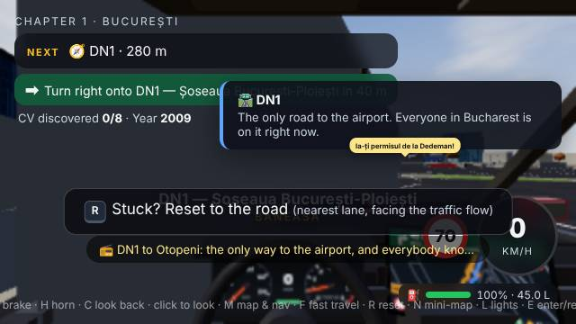
- **high** [b:dn1 · bucharest] following the nav route in its lane on DN1 — Șoseaua București-Ploiești, the car is stopped by a embank wall (static obstacle on a routable lane) — DN1 — Șoseaua București-Ploiești (-1167.8, -5838) · 44.510847, 26.081514
- **high** [f · seattle] following the nav route in its lane on SR-518, the car is stopped by a barrier wall (static obstacle on a routable lane) — SR-518 (276.4, -1113.5) · 47.463539, -122.294258 — 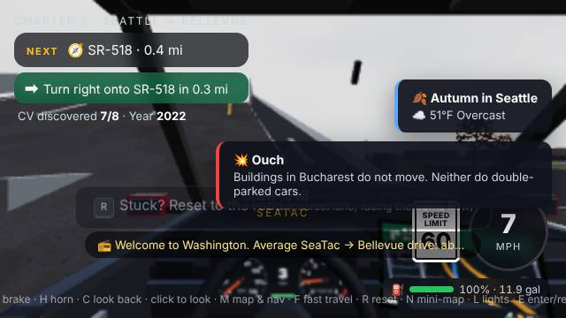
- **high** [f · seattle] following the nav route in its lane on I-405, the car is stopped by a embank wall (static obstacle on a routable lane) — I-405 (4443.1, -8847) · 47.602716, -122.183569

### bad-placement (high, 2)

- **high** [b:dn1 · bucharest] start of DN1: touching a embank — DN1 — Șoseaua București-Ploiești (-1135, -5794.4) · 44.509245, 26.082104 — 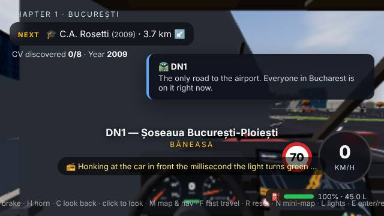
- **medium** [h · seattle] after R reset: 2.1 m from the centreline of (service) (half-width 1.5) — (service) (3799.6, -9674.1) · 47.617601, -122.200665 — 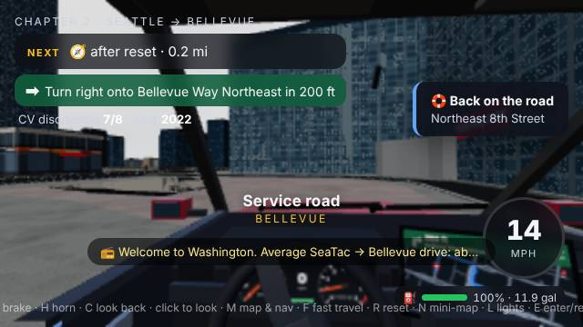

### clipping (high, 2)

- **high** [b:dn1 · bucharest] car passes through a embank (no collision response, overlap 0.69 m) — DN1 — Șoseaua București-Ploiești (-1136.3, -5794.4) · 44.509242, 26.08208 ×483 — 
- **high** [b:dn1 · bucharest] car passes through a rail (no collision response, overlap 1.08 m) — Bretea (-1165.1, -5854.3) · 44.511446, 26.081563 ×382

### route-wrong-level (high, 1)

- **high** [b:dn1 · bucharest] nav route starts on Bretea at y=0.24 but the car is at y=1.51 (route start snapped to a road on another level, nearest in 2D) — Bretea (-1163.6, -5852.5) · 44.511378, 26.08159 ×3

### stop-unreachable (high, 1)

- **high** [f · seattle] could not stop within 11 m of the uipath-bel door (closest 130.5 m) — 106th Avenue Northeast (3858, -9664.2) · 47.617423, -122.199114

### finale-missing (high, 1)

- **high** [f · seattle] left UiPath Bellevue after reading a screen but the finale panel did not open — 106th Avenue Northeast (3862, -9663.7) · 47.617414, -122.199008

### unstick-failed (high, 1)

- **high** [h · seattle] could not drive away after R reset: timeout — Bellevue Way Northeast (3756.7, -9738) · 47.618751, -122.201804 — 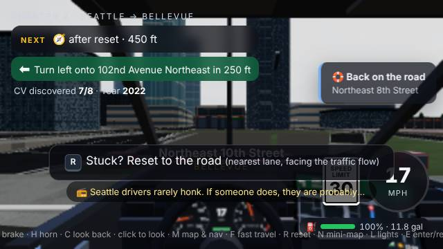

### vehicle-overlap (medium, 251)

Breakdown: 69% near a junction, 1% involve a parked car, 50% on the same edge, 41% both stationary, 0% involve a tram.

- **medium** [b:dn1 · bucharest] hatch 125 and hatch 292 overlap by 1.35 m for 1.1 s — DN1 (-1122.1, -5782.8) · 44.508819, 26.082335 ×63
- **medium** [b:dn1 · bucharest] van 79 and hatch 104 overlap by 2.76 m for 1.3 s — Șoseaua București-Ploiești (-1276.5, -5475.2) · 44.497521, 26.079562 ×20
- **medium** [b:pipera · bucharest] suv 160 and hatch 174 overlap by 1.93 m for 1.3 s — Strada Căpitan Aviator Alexandru Șerbănescu (-144.2, -4316.2) · 44.482283, 26.099909 ×18
- **medium** [b:pipera · bucharest] van 4 and hatch 216 overlap by 1.55 m for 1.3 s — Șoseaua Pipera (276.5, -4344.4) · 44.482647, 26.107469 ×17
- **medium** [b:dn1 · bucharest] hatch 51 and hatch 110 overlap by 0.81 m for 1.3 s — DN1 — Șoseaua București-Ploiești (-1304.8, -6014.8) · 44.517339, 26.079053 ×17
- **medium** [b:dn1 · bucharest] sedan 0 and truck 185 overlap by 1.21 m for 1.3 s — Bulevardul Aerogării (-1292.1, -5274.4) · 44.494601, 26.07928 ×13
- **medium** [b:dn1 · bucharest] hatch 125 and hatch 174 overlap by 2.61 m for 1.3 s — DN1 — Șoseaua București-Ploiești (-1294.4, -6002) · 44.516868, 26.079239 ×13
- **medium** [b:dn1 · bucharest] hatch 129 and hatch 295 overlap by 0.71 m for 1.2 s — DN1 (-1137, -5781.2) · 44.508758, 26.082068 ×12
- … 243 more in latest.json

### ped-in-vehicle (medium, 14)

- **medium** [e · bucharest] pedestrian 105 (walk) inside hatch 149 (moving) — Pasajul Victoria (-872.7, -1957.3) · 44.451961, 26.086819 ×9
- **medium** [b:dn1 · bucharest] pedestrian 94 (legs) inside sedan 221 (moving) — DN1 (-1233.7, -5927.7) · 44.514139, 26.080331 ×7
- **medium** [c · bucharest] pedestrian 50 (legs) inside taxi 165 — Șoseaua Fabrica de Glucoză (68.9, -3809.7) · 44.475773, 26.103739 ×3
- **medium** [b:unirii · bucharest] pedestrian 40 (legs) inside police 478 (moving) — Pasajul Unirii (91.2, 92.7) · 44.425608, 26.10414 ×2
- **medium** [b:unirii · bucharest] pedestrian 232 (wait) inside hatch 139 (moving) — Pasajul Unirii (95, 6.6) · 44.426715, 26.104207 ×2
- **medium** [b:stefan · bucharest] pedestrian 4 (legs) inside suv 237 (moving) — Strada Barbu Văcărescu (131.4, -2050) · 44.453153, 26.104861 ×2
- **medium** [b:pipera · bucharest] pedestrian 69 (walk) inside bus 85 (moving) — Șoseaua Pipera (204.4, -4285.3) · 44.481886, 26.106173 ×2
- **medium** [e · bucharest] pedestrian 109 (walk) inside hatch 149 (moving) — Pasajul Victoria (-881.8, -1956.7) · 44.451953, 26.086654 ×2
- … 6 more in latest.json

### ped-on-carriageway (medium, 6)

- **medium** [a · bucharest] pedestrian 147 (walk) on the carriageway of Șoseaua Grozăvești for > 5 s, not at a crossing — Bulevardul Doina Cornea (-2358.4, -1177.9) · 44.441941, 26.06012
- **medium** [b:pipera · bucharest] pedestrian 19 (wait) on the carriageway of Șoseaua Pipera for > 5 s, not at a crossing — Șoseaua Pipera (190.4, -4272.4) · 44.481721, 26.105922
- **medium** [b:pipera · bucharest] pedestrian 192 (wait) on the carriageway of Șoseaua Pipera for > 5 s, not at a crossing — Șoseaua Pipera (502.4, -4534.6) · 44.485091, 26.111528
- **medium** [b:dn1 · bucharest] pedestrian 232 (legs) on the carriageway of (service) for > 5 s, not at a crossing — (service) (-1027.4, -5765.5) · 44.508182, 26.084038
- **medium** [b:splaiul · bucharest] pedestrian 204 (walk) on the carriageway of Splaiul Independenței for > 5 s, not at a crossing — Splaiul Independenței (-456.5, -355.8) · 44.431374, 26.094297
- **medium** [c · bucharest] pedestrian 22 (wait) on the carriageway of Bulevardul Lascăr Catargiu for > 5 s, not at a crossing — Bulevardul Lascăr Catargiu (-848.2, -1939.2) · 44.451728, 26.087259

### vehicle-overlaps-player (medium, 5)

- **medium** [b:dn1 · bucharest] police 478 overlaps the player by 0.41 m — DN1 — Șoseaua București-Ploiești (-1131.4, -5792.9) · 44.509189, 26.082169 ×59
- **medium** [b:dn1 · bucharest] hatch 104 overlaps the player by 0.68 m — DN1 — Șoseaua București-Ploiești (-1215.7, -5908.8) · 44.513446, 26.080654 ×35
- **medium** [a · bucharest] tram 583 overlaps the player by 0.46 m — Pasajul Basarab (-2341.7, -1248.7) · 44.442851, 26.06042 ×11 — 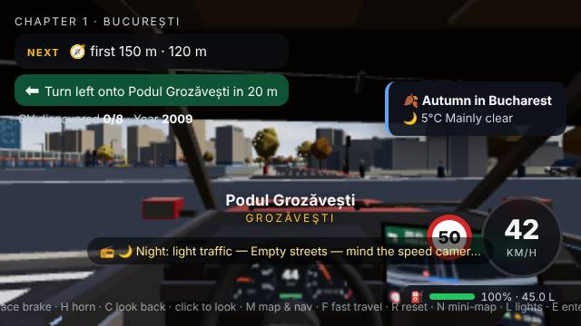
- **medium** [f · seattle] pickup 11 overlaps the player by 0.52 m — 42nd Avenue South (766.7, -1134.7) · 47.46392, -122.281234 — 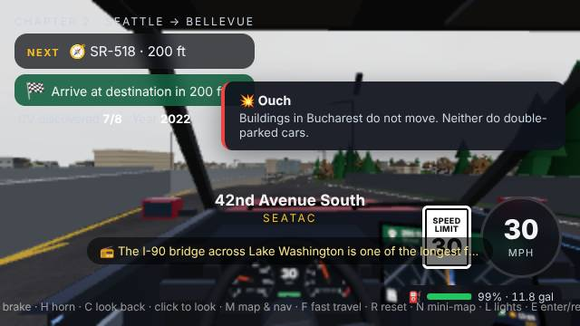
- **medium** [f · seattle] van 59 overlaps the player by 0.62 m — 60th Avenue Southeast (1831.1, -8109.7) · 47.589448, -122.252956 — 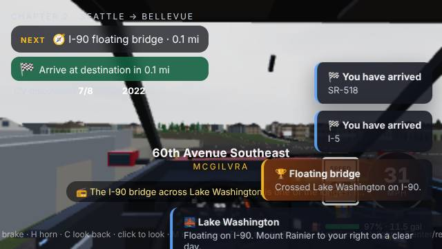

### autopilot-no-progress (medium, 4)

- **medium** [b:pipera · bucharest] no progress toward Șos. Pipera for 30 s — Șoseaua Pipera (499.2, -4526) · 44.484981, 26.11147 — 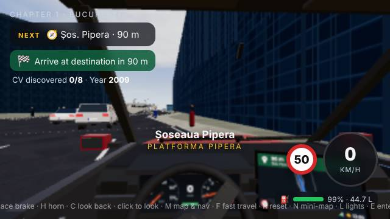
- **medium** [b:dn1 · bucharest] no progress toward DN1 for 30 s — DN1 — Șoseaua București-Ploiești (-1135.4, -5794.5) · 44.509248, 26.082097
- **medium** [c · bucharest] no progress toward db for 30 s — Calea Floreasca (50.9, -3830.4) · 44.476039, 26.103415 — 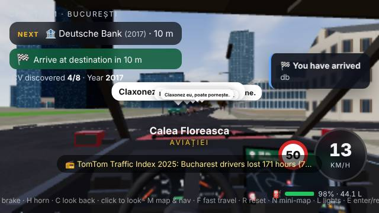
- **medium** [f · seattle] no progress toward UiPath Bellevue for 30 s — Northeast 8th Street (3831.8, -9664.9) · 47.617436, -122.19981

### drive-failed (medium, 2)

- **medium** [b:pipera · bucharest] could not drive Șos. Pipera (362 m): timeout, 85 m left after 85 s — Șoseaua Pipera (507.4, -4519.4) · 44.484895, 26.111617 — 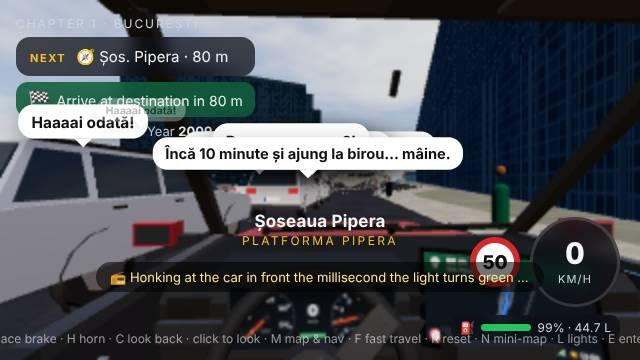
- **medium** [b:dn1 · bucharest] could not drive DN1 (282 m): timeout, 126 m left after 85 s — DN1 (-1223, -5920.9) · 44.513891, 26.080524

### fast-travel-last-mile (medium, 1)

- **medium** [e · bucharest] after fast travel to gts the last 61.3 m could not be driven in 20 s (timeout, 14 m left) — Calea Călărașilor (1025.8, -482.6) · 44.433004, 26.120933 — 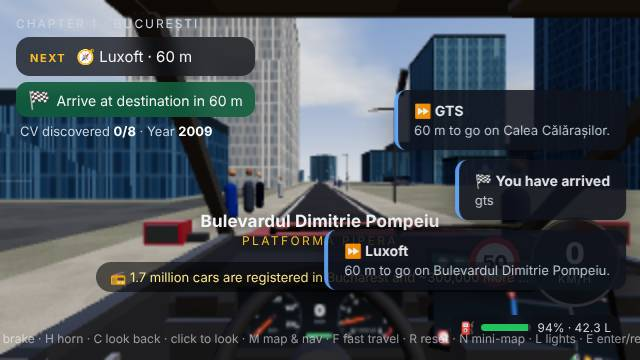

### vehicle-overlap-ghost (low, 6)

- **low** [b:dn1 · bucharest] van 73 and suv 201 overlap by 0.51 m for 1.1 s (deadlock ghosting) — DN1 — Șoseaua București-Ploiești (-1304.1, -6010.4) · 44.517177, 26.079066 ×3
- **low** [b:dn1 · bucharest] hatch 103 and hatch 284 overlap by 1.47 m for 1 s (deadlock ghosting) — DN1 (-1121.1, -5780.1) · 44.508719, 26.082353 ×2
- **low** [b:dn1 · bucharest] taxi 111 and sedan 186 overlap by 1.36 m for 1.1 s (deadlock ghosting) — DN1 (-1225.7, -5923.6) · 44.51399, 26.080474 ×2
- **low** [c · bucharest] taxi 165 and suv 260 overlap by 0.94 m for 1 s (deadlock ghosting) — Calea Floreasca (62.5, -3809.7) · 44.475773, 26.103623 ×2
- **low** [b:magheru · bucharest] sedan 118 and bus 183 overlap by 1.22 m for 1 s (deadlock ghosting) — Bulevardul Dacia (-301.7, -1540) · 44.446596, 26.097079
- **low** [b:dn1 · bucharest] sedan 221 and sedan 235 overlap by 2.74 m for 1.3 s (deadlock ghosting) — Bretea (-1251.8, -5923.4) · 44.513981, 26.080006

### ped-stuck-crossing (low, 3)

- **low** [b:pipera · bucharest] pedestrian 87 has been crossing for > 30 s — Șoseaua Pipera (520.1, -4538.6) · 44.485142, 26.111846
- **low** [b:dn1 · bucharest] pedestrian 129 has been crossing for > 30 s — Strada Jandarmeriei (-1256.3, -5918.8) · 44.513815, 26.079924
- **low** [b:dn1 · bucharest] pedestrian 47 has been crossing for > 30 s — Aleea Privighetorilor (-1310, -6016.2) · 44.517388, 26.07896

### external-request-failed (low, 1)

- **low** [audit · bucharest] Failed to load resource: the server responded with a status of 429 (Too Many Requests) https://api.open-meteo.com/v1/forecast?latitude=44.4300&longitude=26.1000&current=temperature_2m,weather_code,cloud_cover,precipitation,rain,showers,snowfall,snow_depth,wind_speed_10m,wind_direction_10m,visibility,is_day&timezone=Europe%2FBucharest (external service; the game must cope without it) —   ×3

### perf-fps (low, 1)

- **low** [end · seattle] 0.5 fps (2176 ms/frame, 90 draw calls, 151736 tris) at quality low 640×360 in software GL — not representative of real GPUs —  

## Static world audit — bucharest

19359 drivable edges, 17101 nodes, 74052 colliders, 5478 lamps, 688 elevated edges, 192 vehicles / 250 pedestrians spawned (around the spawn) · 2184 ms

world.audit(): props 0, buildings 0, walls 10, lamps 0, cliffs 0, doors 0, wallsTotal 2215, collisionItems 74052 (the world's own self-check; samples listed below as `world.audit:*`)

world.devCheck(): blocked 1, dead ends 86 (the world's own self-check; samples listed below as `world.devCheck:*`)

| type | severity | count |
|---|---|---:|
| cliff-edge | high | 65 |
| world.audit:walls | high | 10 |
| prop-in-road | high | 3 |
| world.devCheck:blocked | high | 1 |
| poi-door-unreachable | medium | 4 |
| poi-door-in-building | medium | 8 |
| prop-over-sunken-road | medium | 1 |
| spawn-ped-in-vehicle | medium | 1 |
| world.devCheck:deadEnds | low | 10 |

### bucharest: cliff-edge (65)

- **high** Șoseaua Orhideelor climbs 4.52 m over 6.6 m (grade 69 %) — Șoseaua Orhideelor (-2308.2, -1440.6) · 44.445319, 26.061021
- **high** (primary) climbs 6 m over 7.1 m (grade 85 %) — (primary) (-2281.1, -1428.2) · 44.44516, 26.061508
- **high** (service) climbs 2.49 m over 2.8 m (grade 89 %) — (service) (-2142.7, -1448.1) · 44.445415, 26.063995
- **high** Pasajul Basarab climbs 4.26 m over 6.5 m (grade 66 %) — Pasajul Basarab (-1714.5, -1954.8) · 44.451929, 26.07169
- **high** (residential) climbs 4.07 m over 4.8 m (grade 85 %) — (residential) (342.2, -2202.7) · 44.455115, 26.108648
- **high** (residential) climbs 4.07 m over 5.3 m (grade 77 %) — (residential) (337.2, -2203.1) · 44.45512, 26.108559
- **high** Strada Căpitan Aviator Alexandru Șerbănescu climbs 3.9 m over 2.1 m (grade 182 %) — Strada Căpitan Aviator Alexandru Șerbănescu (-142.5, -4304.5) · 44.482133, 26.099939
- **high** (service) climbs 2.2 m over 3.5 m (grade 63 %) — (service) (-146.9, -4319.2) · 44.482322, 26.099859
- **high** DN1 — Șoseaua București-Ploiești climbs 2.51 m over 4.6 m (grade 54 %) — DN1 — Șoseaua București-Ploiești (-1123.9, -5775.2) · 44.508541, 26.082303
- **high** DN1 — Șoseaua București-Ploiești climbs 2.26 m over 4.4 m (grade 51 %) — DN1 — Șoseaua București-Ploiești (-1125.2, -5796.1) · 44.509307, 26.08228
- **high** (service) climbs 2.58 m over 2.5 m (grade 101 %) — (service) (-1147.6, -5795.6) · 44.50929, 26.081877
- **high** (service) climbs 2.35 m over 4.6 m (grade 51 %) — (service) (-1154.4, -5789.8) · 44.509075, 26.081755
- **high** DN1 — Șoseaua București-Ploiești climbs 11.08 m over 15 m (grade 74 %) — DN1 — Șoseaua București-Ploiești (-1301.1, -5998.1) · 44.516726, 26.07912
- **high** DN1 — Șoseaua București-Ploiești climbs 4.47 m over 4.8 m (grade 94 %) — DN1 — Șoseaua București-Ploiești (-1870.9, -6408.8) · 44.53181, 26.068879
- **high** Bretea climbs 2 m over 2.1 m (grade 94 %) — Bretea (-1916.5, -6580.8) · 44.538129, 26.068062
- … 50 more in latest.json (`audit.bucharest.issues`)

### bucharest: world.audit:walls (10)

- **high** world.audit() walls: kind=barrier, road=DN1 — Șoseaua București-Ploiești, other=junction — (residential) (-1117.5, -5782.5) · 44.508807, 26.082419
- **high** world.audit() walls: kind=barrier, road=Bretea, other=junction — DN1 — Șoseaua București-Ploiești (-1300.6, -5997.2) · 44.516692, 26.079129
- **high** world.audit() walls: kind=barrier, road=Bretea, other=junction — Bretea (-1836.7, -6403.4) · 44.531611, 26.069495
- **high** world.audit() walls: kind=barrier, road=DN1 — Calea Bucureștilor, other=DN1 — Calea Bucureștilor — DN1 — Calea Bucureștilor (-1824.1, -7425.2) · 44.56914, 26.069721
- **high** world.audit() walls: kind=barrier, road=DN1 — Șoseaua București-Ploiești, other=junction — DN1 — Șoseaua București-Ploiești (-1117.7, -5792.1) · 44.50916, 26.082415
- **high** world.audit() walls: kind=barrier, road=DN1 — Șoseaua București-Ploiești, other=DN1 — Șoseaua București-Ploiești — DN1 — Șoseaua București-Ploiești (-1152.1, -5815.3) · 44.510012, 26.081797
- **high** world.audit() walls: kind=barrier, road=DN1 — Șoseaua București-Ploiești, other=DN1 — Șoseaua București-Ploiești — DN1 — Șoseaua București-Ploiești (-1222.4, -5597.2) · 44.502001, 26.080534
- **high** world.audit() walls: kind=barrier, road=DN1 — Șoseaua București-Ploiești, other=DN1 — Șoseaua București-Ploiești — DN1 — Șoseaua București-Ploiești (-1220, -5598.4) · 44.502045, 26.080577
- **high** world.audit() walls: kind=barrier, road=DN1 — Șoseaua București-Ploiești, other=junction — DN1 — Șoseaua București-Ploiești (-1154.6, -5818.6) · 44.510133, 26.081752
- **high** world.audit() walls: kind=barrier, road=Bretea, other=Bretea — Bretea (-1881.6, -6398.7) · 44.531439, 26.068688

### bucharest: prop-in-road (3)

- **high** tlight (r=0.2) inside a lane of Calea Plevnei: 1.41 m into the carriageway (\|lat\| 9.3 m, half-width 10.5 m) — Bretea (-1403.9, -870.4) · 44.437988, 26.077273
- **high** tlight (r=0.2) inside a lane of Șoseaua București-Ploiești: 0.88 m into the carriageway (\|lat\| 4.6 m, half-width 5.3 m) — Strada Constantin Dobrogeanu-Gherea (-1321.4, -4915.6) · 44.489988, 26.078756
- **medium** tlight (r=0.2) on the kerb line of Strada Halelor: 0.49 m into the carriageway (\|lat\| 6.7 m, half-width 7 m) — Bulevardul Ion Constantin Brătianu (42.6, -174) · 44.429037, 26.103266

### bucharest: world.devCheck:blocked (1)

- **high** world.devCheck() blocked: edge=19356, name=Strada Măguricea — Strada Măguricea (-224, -4351) · 44.482731, 26.098475

### bucharest: poi-door-unreachable (4)

- **medium** fuel GPL Glucoza: door is 19.2 m from the nearest routable lane (interaction radius 12 m) — (service) (601.3, -3044.9) · 44.465941, 26.113305
- **medium** fuel Lukoil: door is 13.4 m from the nearest routable lane (interaction radius 12 m) — Bulevardul Tudor Vladimirescu (-1497.4, 485.3) · 44.420562, 26.075592
- **medium** fuel MOL: door is 14.1 m from the nearest routable lane (interaction radius 12 m) — Strada Witting (-1548.9, -1415.4) · 44.444995, 26.074667
- **medium** fuel Petrom: door is 12.3 m from the nearest routable lane (interaction radius 12 m) — Strada Mântuleasa (634.8, -801.5) · 44.437103, 26.113907

### bucharest: poi-door-in-building (8)

- **medium** fuel Petrom: door point is 3.1 m inside a building footprint — Bulevardul Tudor Vladimirescu (-1547.3, 447.1) · 44.421053, 26.074695
- **medium** fuel Lukoil: door point is 3.2 m inside a building footprint — Bulevardul Tudor Vladimirescu (-1497.4, 485.3) · 44.420562, 26.075592
- **medium** fuel MOL: door point is 2 m inside a building footprint — (service) (470.5, -376.3) · 44.431637, 26.110955

### bucharest: prop-over-sunken-road (1)

- **medium** lamp (r=0.18) at ground level floats over the sunken Bulevardul Corneliu Coposu (road y -4.1 m), 2.08 m inside its ribbon — Bulevardul Corneliu Coposu (444.6, -386.3) · 44.431766, 26.110488

### bucharest: spawn-ped-in-vehicle (1)

- **medium** pedestrian 127 spawned inside hatch 531 — Bulevardul Ion Constantin Brătianu (58.2, -271.2) · 44.430286, 26.103545

### bucharest: world.devCheck:deadEnds (10)

- **low** world.devCheck() deadEnds: node=145, name=, d=12 — (service) (-1888, 122) · 44.425232, 26.068573
- **low** world.devCheck() deadEnds: node=251, name=, d=11.2 — (service) (-1872, 139) · 44.425013, 26.068861
- **low** world.devCheck() deadEnds: node=258, name=, d=5.6 — (residential) (-1587, 111) · 44.425373, 26.073982
- **low** world.devCheck() deadEnds: node=385, name=Strada Mitropolitul Antim Ivireanu, d=7.9 — Strada Mitropolitul Antim Ivireanu (-585, 146) · 44.424923, 26.091988
- **low** world.devCheck() deadEnds: node=688, name=Intrarea Căpitan Gheorghe Preoțescu, d=12.4 — Intrarea Căpitan Gheorghe Preoțescu (-339, 537) · 44.419897, 26.096408
- **low** world.devCheck() deadEnds: node=773, name=Strada Crișului, d=14.7 — Strada Crișului (116, 199) · 44.424242, 26.104584
- **low** world.devCheck() deadEnds: node=1087, name=Intrarea Pielari, d=13.8 — Intrarea Pielari (382, 416) · 44.421452, 26.109364
- **low** world.devCheck() deadEnds: node=1106, name=Intrarea Nestorel, d=13.4 — Intrarea Nestorel (385, 449) · 44.421028, 26.109418
- **low** world.devCheck() deadEnds: node=1289, name=Bulevardul General Paul Teodorescu, d=10.4 — Bulevardul General Paul Teodorescu (-2684, -545) · 44.433806, 26.054269
- **low** world.devCheck() deadEnds: node=1566, name=, d=11.1 — (service) (-1879, 130) · 44.425129, 26.068735

## Static world audit — seattle

33672 drivable edges, 30549 nodes, 75700 colliders, 3238 lamps, 3558 elevated edges, 87 vehicles / 60 pedestrians spawned (around the spawn) · 5337 ms

world.audit(): props 0, buildings 0, walls 42, lamps 0, cliffs 0, doors 0, wallsTotal 12060, collisionItems 75700 (the world's own self-check; samples listed below as `world.audit:*`)

world.devCheck(): blocked 0, dead ends 181 (the world's own self-check; samples listed below as `world.devCheck:*`)

| type | severity | count |
|---|---|---:|
| cliff-edge | high | 485 |
| world.audit:walls | high | 42 |
| prop-in-road | high | 6 |
| height-snap | high | 3 |
| lamp-in-road | high | 2 |
| prop-over-sunken-road | medium | 5 |
| world.devCheck:deadEnds | low | 10 |

### seattle: cliff-edge (485)

- **high** SR-520 climbs 3.51 m over 5.6 m (grade 62 %) — SR-520 (2744.5, -10683.7) · 47.63577, -122.228694
- **high** Southeast 4th Place climbs 1.4 m over 2.6 m (grade 53 %) — Southeast 4th Place (4489.6, -9025.8) · 47.605934, -122.182335
- **high** Ramp climbs 5.8 m over 9.1 m (grade 64 %) — Ramp (4452.6, -8860.2) · 47.602954, -122.183318
- **high** Ramp climbs 2.73 m over 4.5 m (grade 61 %) — Ramp (4438.6, -8947.4) · 47.604524, -122.183689
- **high** 103rd Avenue Northeast climbs 1.83 m over 3.6 m (grade 51 %) — 103rd Avenue Northeast (3717.5, -9262.5) · 47.610194, -122.202845
- **high** 102nd Avenue Southeast climbs 2.18 m over 2.4 m (grade 91 %) — 102nd Avenue Southeast (3668.1, -9260.1) · 47.61015, -122.204159
- **high** (service) climbs 3.41 m over 1.8 m (grade 189 %) — (service) (3669.2, -9225.3) · 47.609525, -122.204128
- **high** (service) climbs 3.96 m over 3.6 m (grade 110 %) — (service) (3731.5, -9235.4) · 47.609706, -122.202473
- **high** (residential) climbs 3.52 m over 5.8 m (grade 61 %) — (residential) (3765.4, -9207.9) · 47.609212, -122.201573
- **high** Bellevue Way Southeast climbs 3.37 m over 3.2 m (grade 104 %) — Bellevue Way Southeast (3766.4, -9224.8) · 47.609515, -122.201546
- **high** Exit → Everett climbs 1.44 m over 2.2 m (grade 65 %) — Exit → Everett (4309.1, -9646.7) · 47.617109, -122.18713
- **high** Ramp climbs 5.78 m over 2.4 m (grade 241 %) — Ramp (4272.9, -9417.9) · 47.612991, -122.188093
- **high** Exit → Everett climbs 6 m over 2.4 m (grade 250 %) — Exit → Everett (4269.9, -9447.3) · 47.613519, -122.188171
- **high** Northeast 10th Street climbs 0.53 m over 0.9 m (grade 58 %) — Northeast 10th Street (4309.3, -9765.2) · 47.619241, -122.187126
- **high** Exit → Northeast 6th Street climbs 5.5 m over 7.4 m (grade 74 %) — Exit → Northeast 6th Street (4249.5, -9559.9) · 47.615547, -122.188713
- … 470 more in latest.json (`audit.seattle.issues`)

### seattle: world.audit:walls (42)

- **high** world.audit() walls: kind=guard, road=I-405, other=Exit → Southeast 8th Street — Exit → Southeast 8th Street (4378.5, -8908.6) · 47.603825, -122.185286
- **high** world.audit() walls: kind=guard, road=SR-519 — Alaskan Way South, other=junction — SR-99 — State Route 99 Tunnel (-1291.6, -8751.9) · 47.601005, -122.335911
- **high** world.audit() walls: kind=barrier, road=Ramp, other=I-405 — Northup Way (4277.1, -10572.1) · 47.633762, -122.18798
- **high** world.audit() walls: kind=barrier, road=Ramp, other=I-405 — Ramp (4274.5, -10564.8) · 47.633631, -122.188049
- **high** world.audit() walls: kind=barrier, road=I-405, other=I--405 Express Toll Lanes — 115th Avenue Northeast (4316.5, -10648.6) · 47.635139, -122.186933
- **high** world.audit() walls: kind=barrier, road=Ramp, other=Ramp — Ramp (-692.9, -8503.8) · 47.59654, -122.320007
- **high** world.audit() walls: kind=barrier, road=Ramp, other=I-5 — Ramp (-702.1, -8371.2) · 47.594153, -122.320251
- **high** world.audit() walls: kind=barrier, road=Ramp, other=junction — Ramp (-952.2, -8263.4) · 47.592213, -122.326895
- **high** world.audit() walls: kind=barrier, road=I-5, other=junction — I-5 (-737.5, -8575.3) · 47.597826, -122.321192
- **high** world.audit() walls: kind=barrier, road=Ramp, other=junction — Ramp (-1061.9, -8163.8) · 47.590421, -122.329809
- **high** world.audit() walls: kind=barrier, road=SR-99 — State Route 99, other=SR-99 — State Route 99 — South Atlantic Flyover (-1322.5, -8200.4) · 47.591079, -122.336732
- **high** world.audit() walls: kind=barrier, road=SR-99 — State Route 99, other=SR-99 — State Route 99 — South Atlantic Flyover (-1323.1, -8199) · 47.591054, -122.336748
- **high** world.audit() walls: kind=barrier, road=, other=junction — (service) (-1188, -9089.2) · 47.607075, -122.333159
- **high** world.audit() walls: kind=barrier, road=Exit → Stewart Street, other=I-5 — Exit → Stewart Street (-1029.6, -9961.5) · 47.622773, -122.328951
- **high** world.audit() walls: kind=barrier, road=SR-99 — State Route 99, other=junction — SR-99 — State Route 99 (-1610.5, -9948.5) · 47.622539, -122.344383
- … 27 more in latest.json (`audit.seattle.issues`)

### seattle: prop-in-road (6)

- **high** tlight (r=0.2) inside a lane of (service): 1.02 m into the carriageway (\|lat\| 2.2 m, half-width 3 m) — (service) (-726.6, -6113.2) · 47.553517, -122.320901
- **high** tlight (r=0.2) inside a lane of Bellevue Way Northeast: 0.89 m into the carriageway (\|lat\| 6.3 m, half-width 7 m) — Bellevue Way Northeast (3759.4, -9857.7) · 47.620905, -122.201733
- **medium** tlight (r=0.2) on the kerb line of Northeast 38th Place: 0.78 m into the carriageway (\|lat\| 2.9 m, half-width 3.5 m) — Northeast 38th Place (3741.6, -11261.2) · 47.646164, -122.202206
- **medium** tlight (r=0.2) on the kerb line of Seattle Boulevard South: 0.75 m into the carriageway (\|lat\| 6.4 m, half-width 7 m) — South Charles Street (-915.1, -8420.6) · 47.595043, -122.32591
- **medium** parked (r=2.5) on the kerb line of (service): 0.41 m into the carriageway (\|lat\| 1.1 m, half-width 1.5 m) — (service) (4266.4, -8959.7) · 47.604745, -122.188263
- **medium** parked (r=2.5) on the kerb line of (service): 0.36 m into the carriageway (\|lat\| 2.6 m, half-width 3 m) — (service) (3996.1, -9276.4) · 47.610445, -122.195444

### seattle: height-snap (3)

- **high** driving on South Spokane Street (y=3.88) the car would be put at y=6.11 (height of West Seattle Bridge): 2 sample(s), up to 2.23 m [player.surfaceAt] — South Spokane Street (-1028.6, -7118.4) · 47.571607, -122.328924
- **high** driving on I-5 — Ship Canal Bridge (y=3.87) the car would be put at y=6.09 (height of I-5 — Ship Canal Bridge): 2 sample(s), up to 2.23 m [player.surfaceAt] — I-5 — Ship Canal Bridge (-789.7, -11351.4) · 47.647787, -122.322579
- **high** driving on I-5 (y=2.1) the car would be put at y=0.24 (height of I-5): 4 sample(s), up to 1.86 m [player.surfaceAt] — I-5 (1418.6, -754.7) · 47.457082, -122.263915

### seattle: lamp-in-road (2)

- **high** lamp (r=0.18) inside a lane of Alaskan Way: 3.53 m into the carriageway (\|lat\| 7.1 m, half-width 10.5 m) — Alaskan Way (-1420.4, -8969.3) · 47.604917, -122.339333
- **medium** lamp (r=0.18) on the kerb line of Southeast 36th Street: 0.66 m into the carriageway (\|lat\| 10 m, half-width 10.5 m) — Southeast 36th Street (5041.6, -7572) · 47.579771, -122.167671

### seattle: prop-over-sunken-road (5)

- **medium** parked (r=2.5) at ground level floats over the sunken (service) (road y -2.2 m), 2.87 m inside its ribbon — (service) (4226.6, -9148.3) · 47.608138, -122.18932
- **medium** parked (r=2.5) at ground level floats over the sunken (service) (road y -4.6 m), 2.4 m inside its ribbon — (service) (4236.7, -9110.1) · 47.607451, -122.189052
- **low** parked (r=2.5) at ground level floats over the sunken (service) (road y -4.6 m), 1 m inside its ribbon — (service) (4239.3, -9110.1) · 47.607451, -122.188983

### seattle: world.devCheck:deadEnds (10)

- **low** world.devCheck() deadEnds: node=37, name=Hunts Point Lane, d=8 — Hunts Point Lane (2870, -10871) · 47.639141, -122.225359
- **low** world.devCheck() deadEnds: node=130, name=Northeast 23rd Place, d=5.7 — Northeast 23rd Place (2876, -10414) · 47.630917, -122.2252
- **low** world.devCheck() deadEnds: node=133, name=Northeast 27th Place, d=11.7 — Northeast 27th Place (2900, -10639) · 47.634966, -122.224562
- **low** world.devCheck() deadEnds: node=168, name=88th Avenue Northeast, d=8.1 — 88th Avenue Northeast (2950, -10756) · 47.637072, -122.223234
- **low** world.devCheck() deadEnds: node=182, name=Northeast 28th Street, d=6.2 — Northeast 28th Street (2665, -10676) · 47.635632, -122.230805
- **low** world.devCheck() deadEnds: node=197, name=80th Avenue Northeast, d=11 — 80th Avenue Northeast (2573, -10744) · 47.636856, -122.233249
- **low** world.devCheck() deadEnds: node=233, name=90th Avenue Northeast, d=7.7 — 90th Avenue Northeast (3058, -11098) · 47.643226, -122.220365
- **low** world.devCheck() deadEnds: node=241, name=Northeast 36th Street, d=12.2 — Northeast 36th Street (3018, -11089) · 47.643064, -122.221427
- **low** world.devCheck() deadEnds: node=278, name=Northeast 32nd Place, d=6.9 — Northeast 32nd Place (2973, -10780) · 47.637504, -122.222623
- **low** world.devCheck() deadEnds: node=615, name=Northeast 39th Place, d=4.8 — Northeast 39th Place (3081, -11212) · 47.645278, -122.219754

## Caveats

- Software GL (SwiftShader): the simulation is stepped at a fixed dt with rendering only for screenshots, so fps numbers are not meaningful; the fps issue is informational (low).
- Traffic, pedestrians and the spawn-overlap audit only cover the ~650 m simulation bubble around the player.
- Collider kinds (tree / lamp / post…) are inferred from radius; world.js does not tag them.
- "invisible-collision" fires when the car is pushed for 2 s at < 0.5 m/s with no vehicle, collider, pedestrian or map edge within ~4 m ahead.
